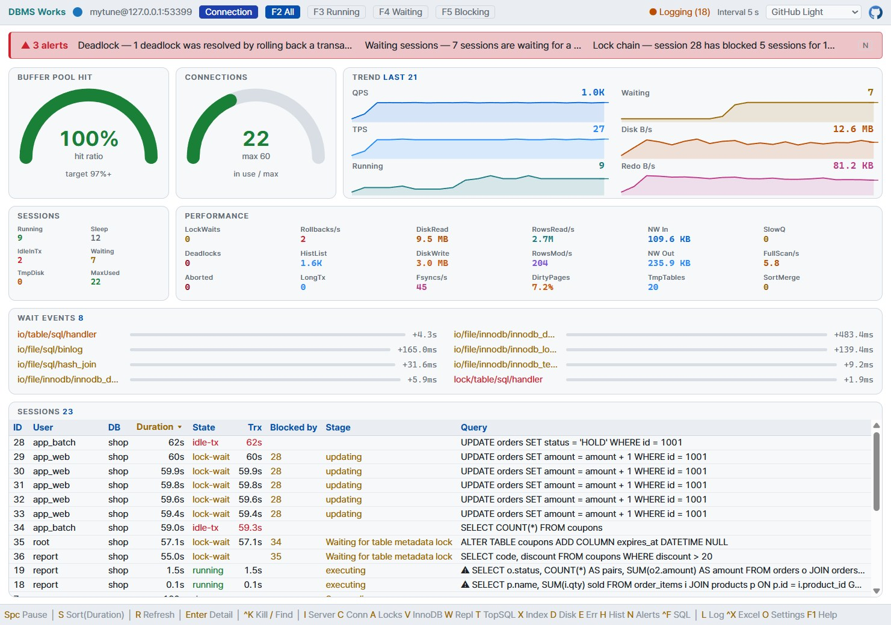
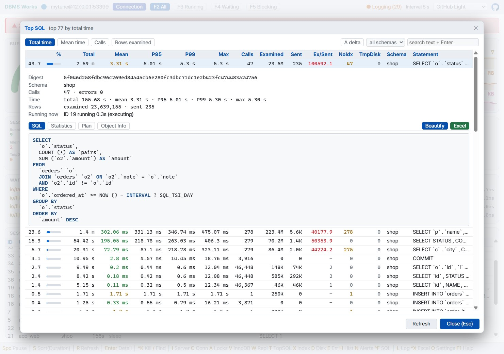
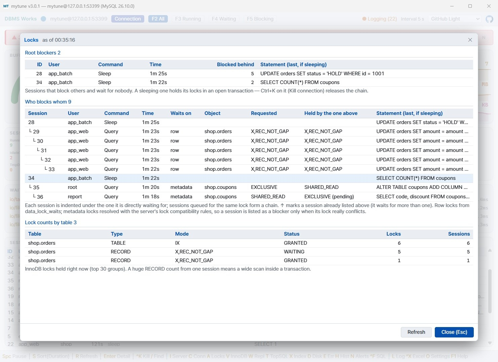
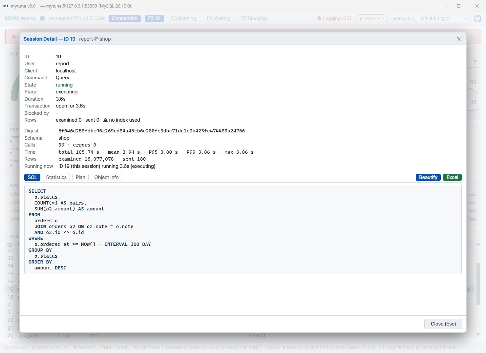
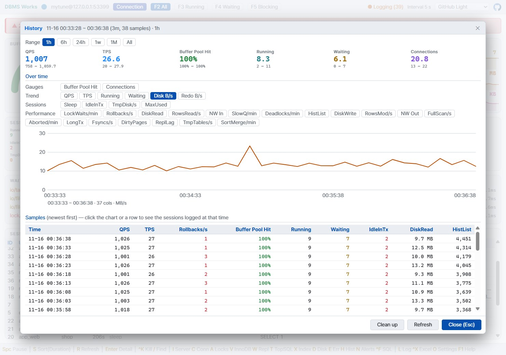
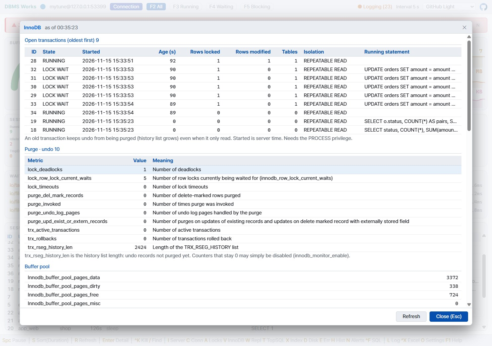
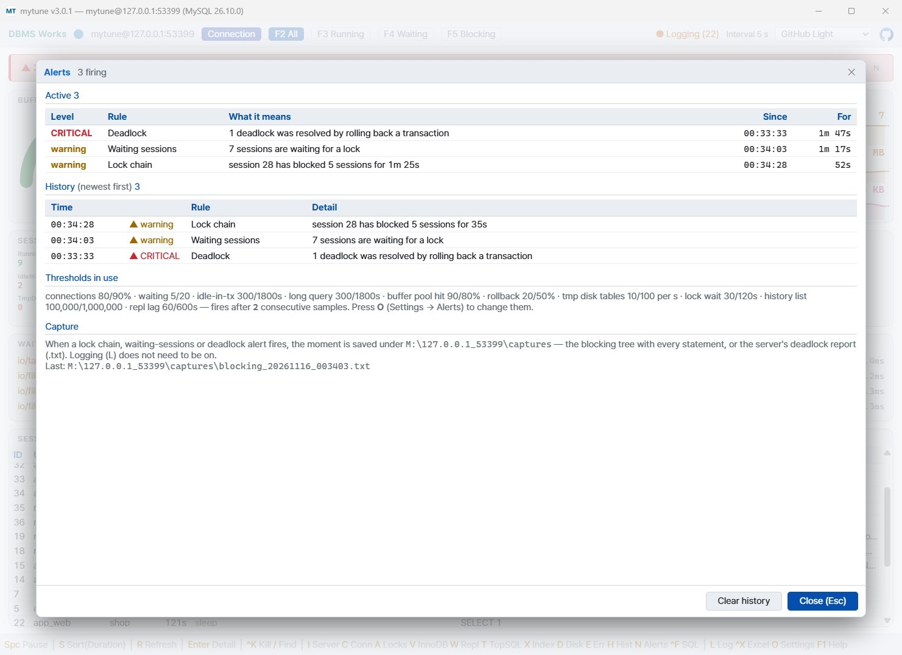
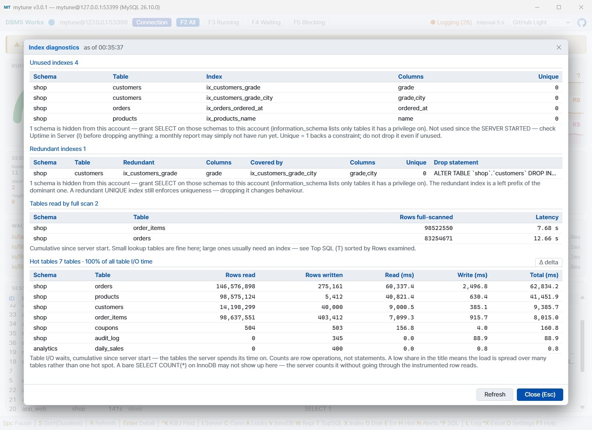
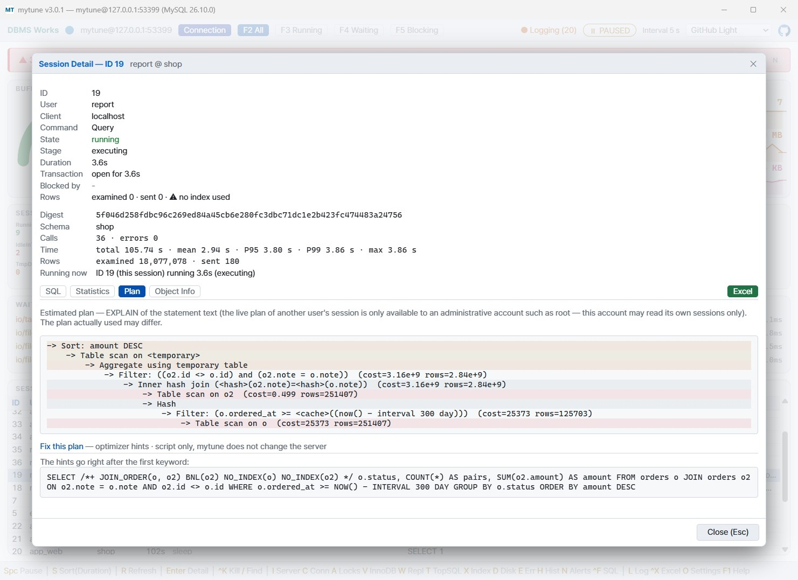
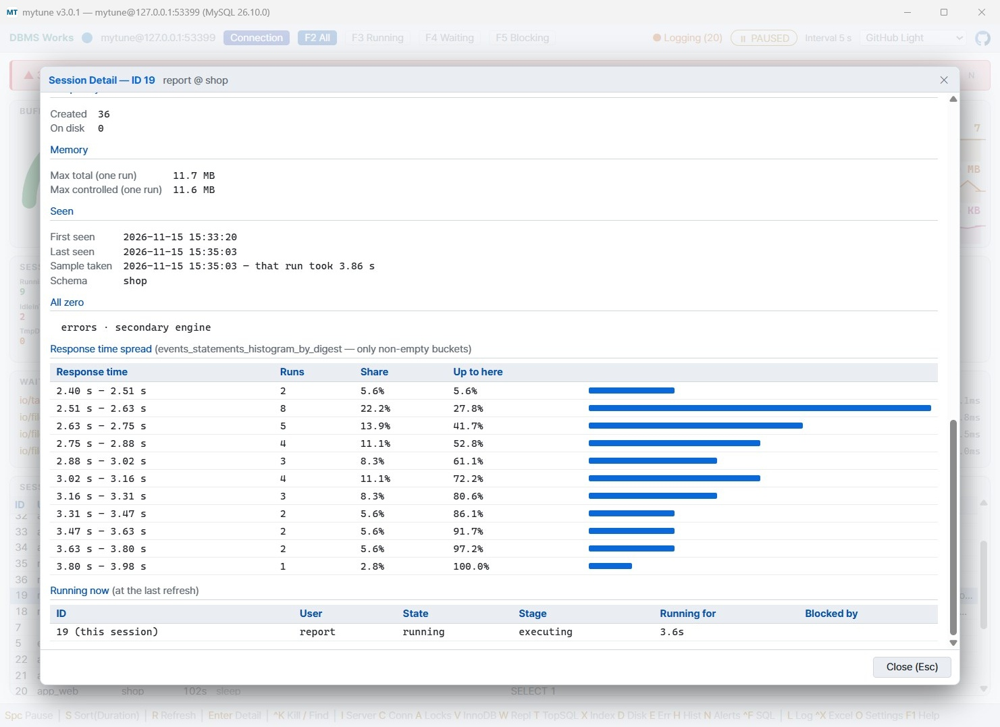

# mytune — MySQL 실시간 모니터 (무료)


**[최신 배포본 내려받기](https://github.com/Doni-Kim/mytune-release/releases/latest)** ·
[English](README.md) · [매뉴얼 (한국어)](mytune.ko.html) · [Manual (English)](mytune.en.html)

MySQL 상태를 실시간으로 보는 데스크톱 모니터입니다. 창 하나 · 실행 파일 하나이고, 서버에는 아무것도 설치하지 않습니다 —
`performance_schema` · `information_schema` · `sys` 만 읽습니다. 부담 없이 쓰시라고 공유드립니다.

## 화면

| 실시간 대시보드 | Top SQL |
|---|---|
|  |  |

| Lock Chain | 세션 상세 |
|---|---|
|  |  |

| History | InnoDB |
|---|---|
|  |  |

| 알림 | 인덱스 진단 |
|---|---|
|  |  |

| 실행 계획 · Fix this plan | 문장 통계 |
|---|---|
|  |  |

화면은 촬영용으로 잠깐 띄운 서버의 가상 `shop` 스키마입니다.

## 설치·설정

- 압축을 풀고 폴더째 둔 뒤 `mytune.exe` 를 실행하면 됩니다 (Single File Publishing).
- .NET 설치 불필요 — 런타임이 실행 파일에 포함되어 있습니다.
- 실행하면 접속 창이 먼저 뜹니다. **+ New** 로 서버를 더하고 호스트 · 포트 · 사용자 · 비밀번호를 넣은 뒤 **Connect**.
  접속과 설정은 실행 파일 옆 `mytune.db` 에 저장됩니다(비밀번호는 암호화).
- 2.x 를 쓰셨다면 `mytune.exe` 만 덮어쓰세요 — 옆의 접속 json 을 처음 실행할 때 옮겨 옵니다(아래).

## 주요 기능

- **실시간 대시보드**: 버퍼 풀 적중률 · 접속 수(게이지), 추이 그래프 여섯 — 왼쪽은 들어온 일(QPS · TPS · Running), 오른쪽은 그 일의 대가(Waiting · 디스크 바이트 · redo 바이트),
  성능 값 열여덟(여섯 묶음) — 락 · 끊긴 접속, 롤백 · history list · 오래 열린 트랜잭션, 디스크 읽기/쓰기 · fsync, 읽고 고친 행 · dirty page, 네트워크 받기/보내기 · 복제 지연, 슬로 쿼리 · 풀 스캔 · 정렬 병합,
  대기 이벤트, 세션 표. 한 지표는 한 곳에만 나옵니다.
  서버의 누적 카운터는 늘 직전 주기와의 차이로 보여 줍니다.
- **진짜 blocker 를 짚는 Lock Chain**: 행 락은 `data_lock_waits` 로, 메타데이터 락은 서버의 락 호환성 규칙으로 판정해 실제로 충돌하는 세션만 blocker 로 냅니다.
  `F5` 는 막는 세션과 막힌 세션을 함께 보여 줍니다.
- **세션 상세**(`Enter`): 문장 전문 · 실행 계획 · 쥔 락 · 접속 속성. `Ctrl+K` 로 쿼리만 또는 접속째 KILL, `Ctrl+X` 로 Excel 저장(시트 넷: 세션 · SQL · 계획 · Objects).
- **Object Info**: 세션 상세와 Top SQL(줄을 누르면)의 `[Object Info]` 가 계획이 읽는 테이블마다 크기 · 컬럼(히스토그램) · 인덱스(이 계획이 쓴 것은 강조, 카디널리티 · 읽기 수) · 파티션을 보입니다.
  계획의 조건에 나온 컬럼에 표시하고, 형 · 콜레이션 변환으로 인덱스를 못 쓴 컬럼(경고 1739)을 ⚠ 로 짚습니다. MySQL 8.3 이상.
- **Find SQL**(`Ctrl+F`): 문장 digest 를 넣으면 Top SQL 을 거치지 않고 그 문장의 통계 · 실행 계획 · Object Info 를 엽니다.
- **SQL 탭**: 상세의 첫 탭(`[SQL] [Plan] [Object Info]`)이 문장이고, 한 줄 문장은 절마다 줄을 바꿔 보여 줍니다. 따옴표 밖의 공백 · 줄바꿈만 바뀌고 글자는 바뀌지 않으며, `[Beautify]` 로 원문과 오갑니다.
- **계획 고정 힌트**(2.12, MySQL 8.0.20 이상): 계획 아래에 지금 계획을 붙잡아 두는 옵티마이저 힌트(JOIN_ORDER · 해시 조인/중첩 루프 · 인덱스)를 문장의 첫 키워드 바로 뒤에 넣어 보입니다(보여 주기만, 실행하지 않음).
- **SQL 창 한 포맷**(2.6): 세션 상세 · Top SQL · Find SQL 이 같은 창 — 요약과 지금 이 문장을 돌리는 세션, digest 요약 표 전부와 응답 시간 분포를 보는 `[Statistics]`, 창마다 `[Excel]`. 실행 계획(TREE)의 줄에 색이 붙습니다(빨강은 조건 없는 조인 · 큰 스캔만).
- **팝업**: Server(`I`) · Connections(`C`) · Locks(`A`) · InnoDB(`V`) · Replication(`W`) · Top SQL(`T`, 델타 · 검색 · 머리글 정렬) · 인덱스 진단(`X`) · Disk(`D`).
- **임계값 알림** 12종: 접속 포화 · 대기 세션 · idle in transaction · 긴 문장 · 버퍼 풀 적중률 · 롤백 비율 · 디스크 임시 테이블 · Lock Chain · 데드락 · history list · 복제 지연 · 복제 스레드 중단. 임계값 0 은 그 단계를 끕니다.
- **History**: `L` 로 로컬 SQLite 에 모니터링 데이터를 쌓고, `H` 로 지난 흐름을 되짚습니다.
  - 구간은 1시간 / 6시간 / 24시간 / 1주 / 1개월 / 전체.
  - 메인 화면에 보이는 값을 전부 그릴 수 있습니다(지표 31가지, 메인 화면의 패널별 · 같은 이름). 바이트 값은 구간마다 단위를 고르고, 기록에 없는 값은 0 으로 그리지 않고 비웁니다.
  - 오래된 기록은 자동으로 지웁니다(기본 지표 30일 · 세션 7일, `O` 설정 창에서 조정).
- Excel 저장: ClosedXML 기반이라 Excel 이 없어도 xlsx 파일이 저장됩니다.
- 접속이 끊기면 스스로 다시 붙습니다.
- **2.2 에서 더한 것**: Error log 팝업(`E`, `performance_schema.error_log`, MySQL 8.0.22 부터) · Server 의 Changed settings 와 Memory in use · Connections 의 Load by user · Index 의 Hot tables · Top SQL 의 P95 / P99.
- **막힘 트리**: Locks(`A`)가 누가 누구를 막는지 트리로 그리고, Excel 에도 사슬 전체가 실립니다.
- **찾기**: `/` 로 세션을 글자로 거릅니다.
- **알림이 켜지는 순간**: 막힘 트리 · 문장 · 데드락 내용을 `captures\` 아래 파일로 남기고, 위험 알림은 창이 앞에 없을 때 작업 표시줄 깜빡임 · Windows 알림으로 알려 줍니다.
- History 에서 한 시점을 누르면 그때 기록된 세션이 나옵니다.
- `sslMode` 에 `verify-ca` · `verify-full`, CA 파일은 `sslCa` — 인증서가 거부되면 접속 창에 사유와 고칠 곳이 나옵니다. Hot tables 는 50줄 · 전체 대비 비율 · `Δ delta`.
- **Admin Reference**: `F1` 의 두 번째 탭에서 서버가 가진 설명을 글자를 칠 때마다 찾습니다 — `sys` 스키마 루틴(설명 · 매개변수 · 예제)과
  `HELP` 가 읽는 서버 도움말 표(명령문 · 함수 700개, 문서 주소 포함). 접속한 서버의 것이라 버전이 저절로 맞고 인터넷이 필요 없습니다.
  자주 쓰는 관리 작업 58개에는 복사해 쓰는 샘플이 있습니다 — mytune 은 관리 명령을 실행하지 않습니다.
- **접속 창**(3.0): 왼쪽은 저장한 접속(마지막에 쓴 것부터), 오른쪽은 고른 접속. **Test** 는 붙어서 서버 판을 보이고 저장 없이 끊고,
  **Connect** 는 붙은 뒤에만 저장합니다.
- **위 줄**(3.0): 주소 앞의 점이 파랑이면 수집 중(누르면 끊음), 빨강이면 재접속 중 · 끊음(누르면 지금 다시 붙음).
  **Connection** 은 창을 닫지 않고 다른 서버로 바꾸고, GitHub 그림은 이 페이지를 엽니다.
- **설정 창**: `O` 로 수집 주기(3~60초, 기본 5초) · 로그 보관 · Top SQL · Excel · 알림 임계값 · `L` 로깅이 남길 세션을 화면에서 고칩니다.
  값을 검사한 뒤 지금 접속의 설정으로 저장하고(Excel 은 모든 접속 공통) 바로 적용합니다.
- **테마 12종**: 밝은 6 · 어두운 6, 기본은 GitHub Light. 상단 바에서 고릅니다.
- **시작할 때 서버가 응답하지 않으면**: 20초 남짓 빈 화면 대신, 누구에게 몇 초째 붙는 중인지 보이는 작은 창이 뜨고 Cancel 로 접속 정보를 고칠 수 있습니다.
- `F1` 을 누르면 단축키 도움말이, 한 번 더 누르면 Admin Reference 탭이 나옵니다.

자세한 사용법은 첨부한 `mytune.ko.html`(스크린샷이 든 매뉴얼)을 참고해 주세요. 사용상 제한 없습니다.

## 지원 범위 · 제약사항

- UI 가 Web 기반(Blazor Hybrid)이라 **Windows 전용**입니다. Linux·macOS 에서는 단독 실행되지 않습니다.
- **MySQL 8.0 이상** + `performance_schema=ON`. 8.0.46 과 최신판에서 확인했습니다.
  `performance_schema` 구성이 같은 MySQL 호환 배포판(Percona Server 8.0+ 등)도 같은 방식으로 동작합니다.
- **MariaDB 는 지원하지 않습니다** — `performance_schema` 에 `data_locks` · `data_lock_waits` 가 없습니다. 접속하면 접속 창에서 알려 줍니다.
- 코드는 ConfuserEx 로 난독화(무료 툴이라 강력한 수준은 아닙니다).

## 모니터링 전용 계정

```sql
CREATE USER 'mytune'@'%' IDENTIFIED BY '...';
GRANT PROCESS ON *.* TO 'mytune'@'%';                  -- 다른 사용자의 세션, innodb_metrics
GRANT SELECT ON performance_schema.* TO 'mytune'@'%';
GRANT SELECT ON sys.* TO 'mytune'@'%';                 -- 인덱스 진단
GRANT REPLICATION CLIENT ON *.* TO 'mytune'@'%';       -- 선택: Replication 팝업 · 복제 알림
GRANT CONNECTION_ADMIN ON *.* TO 'mytune'@'%';         -- 선택: 남의 세션에 Ctrl+K
```

이런 계정에서는 세션 상세의 실행 계획이 *추정 계획*으로 나옵니다(화면에 그렇게 적힙니다). 다른 사용자가 돌리는 문장의 실제 계획은 root 같은 관리자 계정에서만 볼 수 있습니다.

Disk(`D`) · 인덱스 진단(`X`)은 계정이 권한을 가진 스키마만 보입니다 — `information_schema` 가 나머지를 오류 없이 빼기 때문입니다. mytune 이 가려진 스키마 수를 알려 주니, 보려면 그 스키마에 `SELECT` 를 주면 됩니다.

## WebView2 런타임

mytune 은 화면을 Microsoft Edge WebView2 런타임으로 그립니다. 런타임이 없으면 시작할 때 안내 창이 뜨고 끝납니다(2.8 — 그 전 판은 백지 창만 떴습니다).

- **Windows 11**: OS 에 기본 내장이라 항상 있습니다.
- **Windows 10**: 2021년 이후 Windows Update 로 대부분 자동 배포됐지만, 업데이트를 오래 안 한 PC 나 LTSC 같은 특수 에디션에는 없을 수 있습니다.
- **Windows Server (2016/2019/2022)**: 기본 미포함인 경우가 많아 별도 설치가 필요할 수 있습니다.

없으면 Microsoft 의 "에버그린 독립형 설치 프로그램"(`MicrosoftEdgeWebView2RuntimeInstallerX64.exe`)을 설치하시면 됩니다.
→ https://developer.microsoft.com/microsoft-edge/webview2/

WebView2의 캐시는 `mytune.exe` 옆 `WebView2` 폴더에 생깁니다(3.0.1 — 그 전에는 `%LOCALAPPDATA%\mytune.WebView2`이고, 지워도 됩니다).
exe 폴더에 쓸 수 없으면 기본 위치를 씁니다.

## 문제가 생기면

오류가 나면 실행 파일 옆에 `mytune.log` 가 생깁니다(평소에는 만들지 않습니다).

- **버그 · 질문**: [Issues](https://github.com/Doni-Kim/mytune-release/issues) 에 남겨 주세요.
  로그 파일은 거기에 올리지 마세요 — 비밀번호는 없지만 서버 주소와 SQL 문장이 들어 있을 수 있습니다.
- **로그 파일**이나 공개하기 어려운 내용은 메일로 보내 주세요: **doniikim@gmail.com**

## 기술 스택

- .NET 11.0 (x64), C# 15, Blazor Hybrid
- 패키지: MySqlConnector · Microsoft.Data.Sqlite · ClosedXML · Microsoft.Web.WebView2 · Microsoft.AspNetCore.Components.WebView.WindowsForms
- 실행 파일에 묶인 위 오픈소스들의 저작권 고지 · 라이선스 전문: [THIRD-PARTY-NOTICES.txt](THIRD-PARTY-NOTICES.txt) (zip 안에도 들어 있습니다)

## 접속 · 설정 (`mytune.db`, 3.0)

mytune 이 남기는 것은 모두 `mytune.exe` 옆의 `mytune.db` 하나에 있습니다 — 접속, 접속마다의 설정(수집 주기 · 알림 · Top SQL ·
로그 보관 · 로그 필터), 창 위치 · 테마. 설정은 `O` 에서만 고치니 손으로 고치다 깨뜨릴 파일이 없습니다.
새 판으로 바꿀 때는 `mytune.exe` 만 덮어쓰고, `mytune.db` 를 지우면 처음 상태로 돌아갑니다.
암호화된 비밀번호가 들어 있으니 다른 사람에게 그대로 넘기지 마세요.

- **Schema** 는 비워도 됩니다 — mytune 은 서버 전체를 봅니다.
- **SSL mode**: `none` / `preferred`(기본) / `required` / `verify-ca` / `verify-full`. **SSL CA**: 검증 모드가 믿을 CA 파일(.pem) —
  MySQL 이 스스로 만든 인증서는 Windows 저장소에 없으니 서버의 `ca.pem` 을 여기에 적습니다.
- 볼 수 없는 서버(MySQL 8.0 미만 · MariaDB · `performance_schema=OFF`)는 접속 창에서 사유와 함께 막습니다.
- 같은 폴더의 mytune 은 한 번에 하나만 뜹니다. 서버는 위 줄의 **Connection** 으로 바꾸고, 여러 서버를 동시에 보려면 폴더를 나누세요.
- **2.x 에서 올라오는 경우**: 옛 폴더에 `mytune.exe` 를 덮어쓰면, 처음 실행할 때 옆의 접속 json(`mytune.json` · `mytuneNode1.json` · `prod.json` …)을
  한 번 읽어 파일마다 접속 하나로 그 파일의 설정(`sslMode` · `sslCa` 포함)과 함께 옮깁니다. 평문 · 옛 형식 비밀번호는 암호화해 넣습니다.
  json 파일은 고치지도 지우지도 않습니다 — 확인한 뒤 직접 지우세요(평문 비밀번호가 적혀 있었다면 지우는 편이 안전합니다).
  깨진 파일은 건너뛰고, 접속 창에 몇째 줄이 틀렸는지 나옵니다.

## 사용 조건

업무든 개인이든 자유롭게 쓰셔도 됩니다. 실행 파일 재배포와 리버스 엔지니어링은 삼가 주세요.
소스는 공개하지 않습니다.

## 연락처

DBMS Works — **doniikim@gmail.com**

Oracle → PostgreSQL / MySQL 마이그레이션, DB 성능 튜닝 문의도 받습니다.
